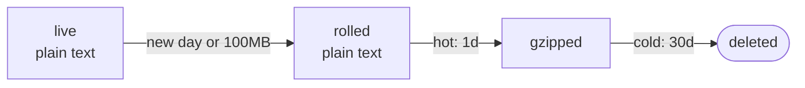

# logchi

[](https://central.sonatype.com/namespace/io.github.rbaxtiyorov)
[](https://github.com/rbaxtiyorov/logchi/actions/workflows/ci.yml)
[](LICENSE)


**Production log files for Spring Boot, from one dependency.** No `logback-spring.xml` and no changes to your
logging code. Add the starter and your app writes log files that rotate, compress and delete themselves, keep
secrets out, and tag every line with the request and user behind it.

[Quick start](#start-in-30-seconds) · [What you get](#what-your-logs-look-like) ·
[Recipes](#recipes) · [Configuration](docs/configuration.md) · [FAQ](#faq)

## Start in 30 seconds

**1. Add the dependency.** It's on Maven Central, so there is no repository or token to set up.

```xml
<dependency>
    <groupId>io.github.rbaxtiyorov</groupId>
    <artifactId>logchi-spring-boot3-starter</artifactId>
    <version>0.1.1</version>
</dependency>
```

On Spring Boot 4, the artifact is `logchi-spring-boot4-starter`.

<details>
<summary>Gradle</summary>

```kotlin
implementation("io.github.rbaxtiyorov:logchi-spring-boot3-starter:0.1.1")
```

</details>

**2. Run your app.** There is no step 3. One line at startup tells you where the logs went:

```
logchi: dir=/app/logs instance=api-7d9f format=text hot=1d cold=30d cap=5GB used=1.4KB(0%) channels=[] levels=[error]
```

```
logs/
├── orders.api-7d9f.txt          every line, live
└── orders-error.api-7d9f.txt    errors only, kept 90 days (appears with the first error)
```

`orders` is your `spring.application.name` and `api-7d9f` is the host or pod name. Every `log.info(...)` you
already have, Lombok's `@Slf4j` and every library's logging end up in those files.

## What your logs look like

```
INFO  [tid=7f3a9c2e41d8b605 uid=ann] c.e.Orders : order created orderId=42 amount=99.5
DEBUG [tid=7f3a9c2e41d8b605 uid=ann] c.e.Payments : → pay(orderId=42, card=***)
WARN  [tid=7f3a9c2e41d8b605 uid=ann] c.e.Payments : ← pay 611ms SLOW(>500ms) PAID durationMs=611
ERROR [tid=9b1c44e07a2d5f13 uid=bob] c.e.Payments : ✗ pay 3ms IOException: timeout durationMs=3
```

Each line starts with a timestamp and thread name, left out here to fit.

- **`tid` and `uid`: which request, which user.** logchi gives every request an id, returns it in the
  `X-Request-Id` response header, and puts it on each line logged while that request is handled.
  `zgrep 7f3a9c2e41d8b605 logs/*` shows the whole request. `uid` comes from Spring Security, or from a header
  you name.
- **`***`: secrets stay out of the file.** `@Mask` hid that argument. Passwords, tokens and card numbers are
  masked without being asked, in messages and in exception text.
- **`SLOW(>500ms)`: slow calls announce themselves.** One annotation, `@Logged(slowerThan = "500ms")`, logs a
  bean's calls. Entry and exit lines are DEBUG, so production at INFO shows only slow calls and failures.
- **`✗`: failures come with their duration and cause**, followed by the stack trace, once.

## Why not just Spring Boot's logging?

Spring Boot can already write a rolling, gzipped log file, which is enough for one application writing one file.
logchi handles what goes wrong after that in production: disks fill up, secrets end up in files, errors get lost
among routine lines, and several pods write to the same volume.

|  | Spring Boot's file logging | logchi |
|---|---|---|
| Turning it on | Set `logging.file.name`, otherwise logs only go to the console | Add the dependency. Files go to `./logs` |
| Retention | Rolled files kept 7 days by default, with an optional size cap | Plain text while recent, gzipped after `hot`, deleted after `cold`. Each level and channel can have its own |
| Errors | Mixed into the main file | Also copied to their own file, kept 90 days by default |
| Secrets | Written as logged | Passwords, tokens, JSON secret fields and card numbers masked before they reach disk |
| Request context | Trace ids once Micrometer Tracing is added | Trace id and user on every line. An incoming `X-Request-Id` is reused and returned |
| Full disk | No special handling | File logging pauses below a free-space floor, and a warning reports how many lines were skipped |
| Many instances, one directory | Processes with the same file name write and roll the same file | Each instance writes its own files, and files left by replaced pods are still compressed and expired |
| Method logging | Written by hand | `@Logged` logs calls and results, flags slow calls and masks `@Mask` arguments |
| JSON | Built in from Boot 3.4 | Any Boot 3 or 4 version, chosen per file |

## Life of a log file



Recent files stay plain text so you can `tail` and `grep` them. Older ones shrink, then disappear. `hot` and
`cold` count from the file's last write. Two safety nets sit on top: when the folder passes `max-total` (5GB)
the oldest rolled files go first, and when free disk drops below `min-free-disk` (1GB) file logging pauses
instead of filling the disk.

## Recipes

Everything below is optional. Each recipe is the whole change.

- [Get a logger without boilerplate](#get-a-logger-without-boilerplate)
- [Find everything that happened in one request](#find-everything-that-happened-in-one-request)
- [See which methods are slow or failing](#see-which-methods-are-slow-or-failing)
- [Keep errors longer than everything else](#keep-errors-longer-than-everything-else)
- [Write an audit trail](#write-an-audit-trail)
- [Send JSON to Elasticsearch, Loki or Datadog](#send-json-to-elasticsearch-loki-or-datadog)
- [Give a noisy logger its own file](#give-a-noisy-logger-its-own-file)
- [Hide a secret logchi doesn't know about](#hide-a-secret-logchi-doesnt-know-about)
- [Put the tenant on every line](#put-the-tenant-on-every-line)
- [Run many pods on one volume](#run-many-pods-on-one-volume)
- [Stop logs from filling the disk](#stop-logs-from-filling-the-disk)
- [Turn the console off in production](#turn-the-console-off-in-production)
- [Keep log files out of your tests](#keep-log-files-out-of-your-tests)
- [Use it without Spring](#use-it-without-spring)

### Get a logger without boilerplate

```java
import io.github.rbaxtiyorov.logchi.core.Loggers;
import io.github.rbaxtiyorov.logchi.spring.annotation.Log;
import org.slf4j.Logger;

@Service
public class OrderService {
    @Log private Logger log;                               // in Spring beans
}

public class PriceMath {
    private static final Logger log = Loggers.get();       // any other class
}
```

Both are standard SLF4J loggers. Values you attach become `key=value` in text and real fields in JSON:

```java
log.atInfo().addKeyValue("orderId", 42).addKeyValue("amount", 99.5).log("order created");
// order created orderId=42 amount=99.5
```

### Find everything that happened in one request

Every response carries its id:

```
X-Request-Id: cdccedcf8da5674c
```

```bash
zgrep cdccedcf8da5674c logs/*        # live and compressed files alike
```

If the caller sends its own `X-Request-Id`, logchi uses that one, so an id can follow a call across services.
The id also follows work onto `@Async` threads.

### See which methods are slow or failing

```java
@Service
@Logged(slowerThan = "500ms")     // every public method, or put it on a single method
public class Payments {
    public String pay(long orderId, @Mask String card) { ... }
}
```

```
DEBUG c.e.Payments : → pay(orderId=42, card=***)
DEBUG c.e.Payments : ← pay 213ms PAID
WARN  c.e.Payments : ← pay 611ms SLOW(>500ms) PAID durationMs=611
ERROR c.e.Payments : ✗ pay 1203ms IOException: gateway down durationMs=1203
```

To set one threshold for every `@Logged` in the app, use `logchi.logged.slower-than: 500ms`.
All options are under [`@Logged` options](#logged-options) and [Logged](docs/configuration.md#logged).

### Keep errors longer than everything else

```yaml
logchi:
  file:
    retention: { hot: 1d, cold: 14d }
  levels:
    error: { cold: 365d }      # orders-error.<instance>.txt
    warn:  { cold: 60d }       # any level can have its own file
```

A level file is a copy. The lines stay in the main file too, so the main file still tells the whole story.
More in [Levels](docs/configuration.md#levels) and [Retention](docs/configuration.md#retention).

### Write an audit trail

```java
import io.github.rbaxtiyorov.logchi.core.Channels;

Channels.get("audit").info("refund approved orderId={}", id);
```

```yaml
logchi:
  channels:
    audit: { cold: 365d, format: json, async: false }
```

A channel has its own file (`orders-audit.<instance>.txt`) and its own retention, and its lines stay out of the
main log unless you add `additive: true`. With `async: false` each line is written before the call returns
instead of being queued. More in [Channels](docs/configuration.md#channels).

### Send JSON to Elasticsearch, Loki or Datadog

```yaml
logchi:
  file:
    format: json          # the console stays readable text
    json-flavor: ecs      # ecs | logstash | compact
```

```json
{
  "@timestamp": "2026-11-10T12:04:59.637Z",
  "ecs.version": "8.11",
  "log.level": "INFO",
  "log.logger": "logchi.channel.audit",
  "message": "order approved item=book",
  "process.thread.name": "http-nio-8080-exec-2",
  "service.name": "orders",
  "service.instance.id": "api-7d9f",
  "trace.id": "cdccedcf8da5674c",
  "user.id": "alice",
  "tenantId": "acme"
}
```

That is one line in the file, spread out here to read. If your platform collects container output instead of files, use `logchi.console.format: json`. Field names for each flavor are listed under [File](docs/configuration.md#file).

### Give a noisy logger its own file

No code change needed. Name the logger, and its lines move out of the main file into their own, with their own
retention:

```yaml
logchi:
  channels:
    http:
      cold: 7d
      console: true              # keep printing them on the console
      loggers: [com.example.web.HttpLoggingFilter]
  multiline-loggers:             # only if that logger writes multi-line messages
    - com.example.web.HttpLoggingFilter
```

More in [Channels](docs/configuration.md#channels) and [General](docs/configuration.md#general).

### Hide a secret logchi doesn't know about

Out of the box, logchi masks values whose key looks like a password, token, secret, authorization or CVV, plus
numbers that pass the card checksum. Add your own:

```yaml
logchi:
  mask:
    keys: [ssn, iban]                        # added to the built-in list
    patterns: ['\b\d{3}-\d{2}-\d{4}\b']      # anything matching is replaced with ***
```

For method arguments, annotate the parameter: `pay(long orderId, @Mask String card)`.
What is and isn't caught is shown under [Mask](docs/configuration.md#mask).

### Put the tenant on every line

```yaml
logchi:
  context:
    user-id: header:X-User-Id        # default is the Spring Security principal
    extra-headers: [X-Tenant-Id]     # becomes tenantId
```

```
INFO  [tid=cdccedcf8da5674c uid=alice tenantId=acme] c.e.OrderService : order created
```

More in [Context](docs/configuration.md#context).

### Run many pods on one volume

Mount the volume and point logchi at it. That is all:

```yaml
logchi:
  dir: /var/log/orders
```

Each pod writes only its own files (`orders.<pod-name>.txt`), so pods never fight over a file. When a pod is
replaced, the remaining pods compress and expire the files it left behind. Without a mounted volume, log files
disappear with the container.

### Stop logs from filling the disk

```yaml
logchi:
  file:
    retention:
      max-total: 2GB          # past this, the oldest rolled files are deleted first
      min-free-disk: 500MB    # below this, file logging pauses
```

When logging pauses, a warning reports how many lines were skipped, and it resumes once space is back.

`max-total` counts every logchi file in the folder, audit and error files included, so size it for your longest
retention.

### Turn the console off in production

```yaml
logchi:
  console:
    enabled: false
```

### Keep log files out of your tests

Send them to the build folder, where `mvn clean` removes them:

```java
@SpringBootTest(properties = "logchi.dir=target/logs")
```

To write no files at all in tests, use `logchi.file.enabled=false`.

### Use it without Spring

Depend on `logchi-core` instead of a starter:

```java
LoggerContext context = (LoggerContext) LoggerFactory.getILoggerFactory();
LogchiSettings settings = new LogchiSettings();
settings.setAppName("orders");
LogchiInstaller.install(context, settings);
Runtime.getRuntime().addShutdownHook(new Thread(context::stop));
```

The shutdown hook flushes queued lines on exit.

## Reference

### Configuration

Everything is optional. These are the settings people change most, with their defaults:

```yaml
logchi:
  dir: ./logs
  console:
    enabled: true
  file:
    format: text                   # text | json
    rotation:
      period: daily                # hourly | daily | none
      max-size: 100MB
    retention:
      hot: 1d                      # then gzip
      cold: 30d                    # then delete
      max-total: 5GB
      min-free-disk: 1GB
  levels:
    error: { cold: 90d }
```

**[Configuration reference](docs/configuration.md)** covers every key: its default, the values it accepts, what
it does and when to change it, plus ready-made setups for development, one server, Kubernetes and JSON shipping.

- Durations look like `500ms`, `5m`, `30d`. Sizes look like `100MB`, `5GB`.
- A value logchi can't read stops startup with a message naming it.
- IDEs with Spring support autocomplete every key in `application.yml`.

### `@Logged` options

| Option       | Meaning                                                              |
|--------------|----------------------------------------------------------------------|
| `slowerThan` | Past this duration the exit line becomes WARN and is tagged `SLOW`   |
| `level`      | Level of the entry and exit lines, such as `Logged.Level.INFO`       |
| `onError`    | Level of the line logged when the method throws                      |
| `args`       | Log arguments                                                        |
| `result`     | Log the return value                                                 |
| `maxLength`  | Longest rendered value. Collections always appear as `[size=N]`      |

`@Logged` works through Spring proxies, with the same limits as `@Transactional`: the class must be a Spring
bean and not `final`, and a call from inside the same object (`this.foo()`) is not logged.

### Lines and files

A full text line:

```
2026-11-10 17:04:59.637+05:00 INFO  [http-nio-8080-exec-2] [tid=cdccedcf8da5674c uid=alice tenantId=acme] c.e.OrderService : order created item=book amount=99.5
```

A full folder:

```
logs/
├── orders.api-7d9f.txt                     live
├── orders.api-7d9f.2026-11-08.0.txt        rolled, not yet compressed
├── orders.api-7d9f.2026-11-07.0.txt.gz     compressed
├── orders-error.api-7d9f.txt               level file
├── orders-audit.api-7d9f.txt               channel file
└── .logchi/                                lock files
```

<details>
<summary>How several instances share a folder safely</summary>

Each process writes only to files carrying its own instance id, which defaults to the pod name in Kubernetes. If
two processes end up with the same id, such as two JVMs on one machine, an OS file lock detects it and the later
one adds its pid. Instances never share a file.

With `scope: shared`, each instance also compresses and expires files left by instances that no longer exist. A
lock file stops instances duplicating that work, and a dead instance's live file is only touched after an hour of
silence.

File locks can be unreliable on network file systems. logchi stays safe there because every retention step can be
repeated harmlessly.

</details>

## FAQ

**Do I have to change my logging code?**
No. logchi sits under SLF4J, so existing loggers, Lombok's `@Slf4j` and third-party libraries all go through it.

**Does it replace Logback or my `logback-spring.xml`?**
No. It is built on Logback and adds its own appenders. A custom `logback-spring.xml` keeps working: logchi
replaces console appenders so lines don't print twice, and leaves every other appender alone.

**I already set `logging.file.name`.**
Remove it. Otherwise Spring Boot keeps writing its own file next to logchi's.

**How do I change what gets logged?**
With `logging.level.*`, as always.

**Can logging slow my app down or crash it?**
Lines go through a queue to a background thread. If the queue is nearly full, INFO and below are dropped while
WARN and ERROR wait for space. If the disk fills or a file can't be written, your code never sees an exception:
logchi counts the lost lines, retries, and logs a warning with the count.

**Do I lose lines on shutdown?**
Not on a normal stop. Queued lines are flushed when the app shuts down, for up to `flush-timeout` (5s).

**My `@Log` field is `null`.**
The class isn't a Spring bean. For classes Spring doesn't manage, use `Loggers.get()`. Lombok has an unrelated `@Log` for classes, so check the import is logchi's.

**`@Logged` logs nothing.**
Entry and exit lines are DEBUG: set `logging.level.com.yourapp=DEBUG`, or use `@Logged(level = Logged.Level.INFO)`.
Also check that the class is a Spring bean, isn't `final`, and that the call comes from another bean.

**Does it work with WebFlux?**
Yes. The trace id is returned in the response and put in the Reactor context. To see it in log lines, add
`io.micrometer:context-propagation` and set `spring.reactor.context-propagation=auto`.

**Is masking a guarantee?**
No. It is pattern-based: it catches common shapes such as `password=x`, JSON fields and card numbers, but it can't
recognize a secret with no recognizable key. Use `@Mask`, and avoid logging secrets in the first place.

## Compatibility

- Java 17 or newer. CI runs Java 17, 21 and 25.
- Spring Boot 3 with `logchi-spring-boot3-starter`, Spring Boot 4 with `logchi-spring-boot4-starter`.
- Planned next: an actuator endpoint showing logchi's state, and search across compressed files.

<details>
<summary>Building from source</summary>

```bash
./mvnw verify
```

| Module                        | Purpose                                                       |
|-------------------------------|---------------------------------------------------------------|
| `logchi-core`                 | Appenders, encoders, retention, masking. Needs only Logback.  |
| `logchi-spring-common`        | Spring source shared by both starters. Not a published jar.   |
| `logchi-spring-boot3-starter` | That source compiled against Spring Boot 3.                   |
| `logchi-spring-boot4-starter` | That source compiled against Spring Boot 4.                   |
| `samples/`                    | A small application for each Boot version.                    |

</details>

## License

[Apache License 2.0](LICENSE)
